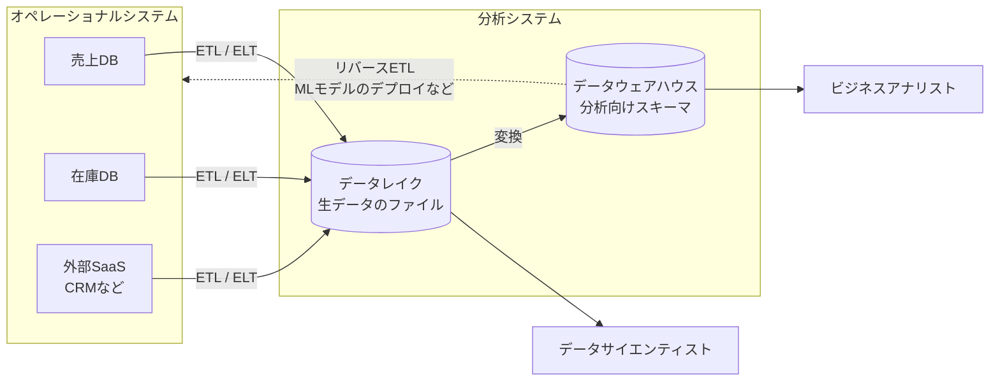
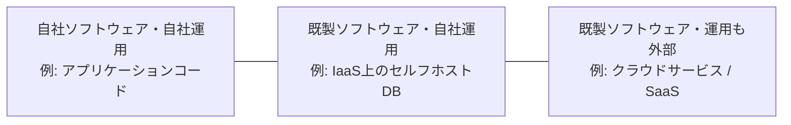

# 1章 データシステムアーキテクチャにおけるトレードオフ

> 解決策などというものはありません。あるのはトレードオフだけです。
> ― Thomas Sowell

『データ指向アプリケーションデザイン 第2版』1章（p.1–30）のサマリー。

## この章で言いたいこと

- データシステムの設計に「唯一の正解」はない。あるのは長所と短所を持つ複数の選択肢だけ
- 本章では、アーキテクチャを左右する **4つの対立軸** を比べ、以降の章で使う用語を定義する

| 対立軸 | 問い |
|---|---|
| オペレーショナル vs 分析 | 誰が、どんなアクセスパターンでデータを使うのか？ |
| クラウド vs セルフホスティング | 作るか買うか、自分で運用するか任せるか？ |
| 分散 vs 単一ノード | 本当に複数マシンが必要か？ |
| ビジネス vs 法律・社会 | そのデータ、本当に持つべきか？ |

### 前提となる用語

- **データ指向（data-intensive）**: データの量・変化・一貫性・可用性が主な課題になるアプリケーション。計算の並列化が課題になる計算指向（compute-intensive）と対比される
- アプリは **構成要素（building block）** の組み合わせでできている: データベース / キャッシュ / 検索インデックス / ストリーム処理 / バッチ処理
- **フロントエンド / バックエンド**: 本書は主にバックエンドの話。バックエンドのアプリコードはたいていステートレスで、状態はデータインフラストラクチャ側に置く

---

## 1.1 オペレーショナルシステムと分析システム

データに関わる人は大きく3種類いる。

- **バックエンドエンジニア**: データを読み書きするサービスを作る
- **ビジネスアナリスト**: 経営判断のためのレポートを作る（BI）
- **データサイエンティスト**: 分析やML/AIで知見やプロダクト機能（レコメンドなど）を作る

ここから2種類のシステムに分かれる。

- **オペレーショナルシステム**: データが生まれる場所。ユーザー操作に応じてDBを読み書きする
- **分析システム**: オペレーショナルシステムのデータの **読み取り専用コピー** を持ち、分析向けに最適化されている

両者をつなぐ役割として **データエンジニア**（データ基盤全体の統合）と **アナリティクスエンジニア**（分析しやすいようにデータをモデリング・変換）が生まれた。

### OLTP と OLAP（表1-1 より抜粋）

| 特性 | OLTP（オペレーショナル） | OLAP（分析） |
|---|---|---|
| 読み取り | ポイントクエリ（キーで少数のレコードを取る） | 大量レコードの集約 |
| 書き込み | 個別レコードの作成・更新・削除 | バルクインポート（ETL）、イベントストリーム |
| クエリ | アプリが事前に決めた固定クエリ | アナリストによるアドホックな探索 |
| データが表すもの | 現時点の最新状態 | 時間とともに起きたイベントの履歴 |
| サイズ | GB〜TB | TB〜PB |

- OLTPではユーザーに任意のSQLを書かせない（権限の問題、重いクエリによる性能劣化）
- 分析ワークロードをユーザー向けプロダクトに組み込むものは **プロダクトアナリティクス / リアルタイムアナリティクス**（Pinot、Druid、ClickHouse）と呼ぶ

### データウェアハウスとデータレイク

1980年代後半から、分析はOLTPとは **別のDB（データウェアハウス）** で行うようになった。OLTPに直接クエリしない理由は次の4つ。

1. データが複数システムに散らばっていて結合できない（**サイロ化**）
2. OLTP向けのスキーマは分析に向かない
3. 重い分析クエリが本番ユーザーの性能を落とす
4. セキュリティ上、OLTPは別ネットワークに置かれていることがある

- **ETL**: 抽出（Extract）→ 変換（Transform）→ ロード（Load）。DWHに入れてから変換する場合は **ELT**
- **データレイク**: 形式やスキーマを強制せず、ファイルとしてなんでも置く場所。オブジェクトストアを使えるので安い。データサイエンティストはSQLよりPandasやSparkを好むため、生データ（**寿司の原則**: 生データの方がよい）が欲しい
- **HTAP**: 1つのシステムでOLTPと分析を両立する試み。ただし中身は分離されていることが多く、DWHの代わりにはならない
- 分析の出力をオペレーショナル側に戻すこともある（**リバースETL**）。ストリーム処理により分析も秒単位で応答できるようになってきた
- 大きな流れとして、スケールが大きくなるほどシステムは特定のワークロード向けに特化していく

### 記録のシステムと導出データ

- **記録のシステム（source of truth）**: データの正本。新しいデータは最初にここへ書かれ、食い違いがあればこちらが正しい
- **導出データシステム**: 別のデータを変換・加工した結果。失っても元から作り直せる。例: キャッシュ、インデックス、マテリアライズドビュー、非正規化した値、学習済みモデル

ポイントは、**この区別はツールではなく使い方で決まる** こと。同じDBでも使い方次第でどちらにもなる。どのデータがどこから導出されているかを明確にすると、アーキテクチャの見通しがよくなる（詳しくは11章）。

---

## 1.2 クラウドとセルフホスティング

要は **作るか買うか（build or buy）**。競争優位になるものは自社で、ありふれたものはベンダーに任せる、が経験則。

左ほど制御性が高く投資が大きい。右ほど制御性が低く投資が小さい（図1-2）。

### クラウドの利点と欠点

| クラウドが有利 | セルフホストが有利 |
|---|---|
| まだ運用の仕方を知らないシステムを使うとき | 運用経験があり、負荷が予測できるとき（その方が安いことが多い） |
| 負荷の変動が大きいとき（分析システムが典型） | 自社のワークロードに合わせたチューニングが必要なとき |
| 専門業者の運用ノウハウを買えるとき | 高頻度取引のようにハードウェアの完全な制御が必要なとき |

クラウドの最大の欠点は **自分でコントロールできない** こと。

- 欲しい機能はベンダーにお願いするしかない
- 落ちたら復旧を待つしかない
- 内部のログやメトリクスが見えず、診断が難しい
- サービス終了・値上げ・仕様変更に振り回される（**ベンダーロックイン**）
- 政治的対立による制裁、データの安全性をベンダーに委ねることによるコンプライアンスの複雑化

### クラウドネイティブなアーキテクチャ

最初からクラウド向けに設計されたシステム（Aurora、Spanner、Snowflake、BigQueryなど）は、同じハードウェアでの性能、障害からの復旧、スケーリング、扱えるデータ量で有利とされる。

- **サービスのレイヤリング**: OSの資源（CPU・RAM・ファイルシステム）の上ではなく、**下位のクラウドサービスの上に上位のサービスを作る**（例: S3の上にSnowflake、さらにその上に別のサービス）
- **ストレージとコンピュートの分離**: ローカルディスクは一時キャッシュとして扱い、永続化はS3などの専用ストレージサービスに任せる。仮想ディスク（EBSなど）はI/Oがすべてネットワーク呼び出しになるので不安定さに弱い
- **マルチテナント**: 複数顧客のデータと計算を同じハードウェアで処理する。利用率は上がるが、他の顧客への影響を抑える工夫が要る

### クラウド時代の運用

DBA・システム管理者から **DevOps / SRE** へ。クラウドでも運用は不要にならず、焦点が変わるだけ。

- キャパシティプランニング → **財務計画**、性能最適化 → **コスト最適化**
- リソース制限やクォータを事前に把握しておく
- サービス間の統合が大きな課題（標準がなく手作業が多い）
- セキュリティ、監視、障害の原因追跡は外に任せられない

---

## 1.3 分散システムと単一ノードシステム

複数マシンがネットワーク越しに通信するのが **分散システム**、参加する各プロセスを **ノード** と呼ぶ。分散にする理由は次のとおり。

- 本質的に分散している（複数ユーザーが自分のデバイスを使う）
- クラウドサービス間のリクエスト
- 耐障害性 / 高可用性
- スケーラビリティ
- レイテンシ（ユーザーの近くにサーバーを置く）
- 弾力性（負荷に応じて増減）
- 専用ハードウェア（GPUなど）
- 法的コンプライアンス（データレジデンシー法）
- 持続可能性（再エネが余っている時間・場所で動かす）

### 分散システムの問題

- リクエストは失敗しうる。タイムアウトしたとき、相手が受け取ったかどうかわからないので、単純なリトライが安全とは限らない（9章）
- ネットワーク越しの呼び出しは関数呼び出しよりはるかに遅い。**1台のシングルスレッドプログラムが100コア超のクラスタに勝つこともある**
- トラブルシューティングが難しい → **オブザーバビリティ**（OpenTelemetryなどのトレーシング）
- サービスごとにDBを持つと、サービス間の一貫性はアプリ側の責任になる

結論として、**単一マシンで済むなら急いで分散させない方がよい**。ハードウェアは速く大きくなっており、DuckDB・SQLiteなどの単一ノードDBで多くのワークロードをさばける。

### マイクロサービスとサーバーレス

- **マイクロサービス**: 1つの明確な目的を持つサービスを、1チームが1つ持つ。サービス同士でDBは共有しない（共有するとDB構造がAPIの一部になってしまう）
  - 利点: 独立してデプロイでき、チーム間の調整が減る
  - 欠点: テストが複雑、サービスごとにインフラが要る、APIの進化が難しい
  - **本質的には人の問題（チーム間の調整）に対する技術的な解決策**。チームが少ない小さな会社ではオーバーヘッドになりやすい
- **サーバーレス（FaaS）**: コードの実行にも従量課金を持ち込んだもの。実行時間の制限やコールドスタートがある

### クラウドとスーパーコンピュータ（HPC）

| | クラウド | HPC |
|---|---|---|
| 用途 | オンラインサービス、ビジネスデータ | 天気予報、分子動力学などの科学技術計算 |
| 障害時 | 止めずに提供を続ける | 全体を止めてチェックポイントから再開 |
| 信頼モデル | 互いを信頼しない組織同士で共有 → 分離・暗号化・認証 | ユーザー間の信頼が前提（共有メモリ、RDMA） |
| 配置 | 複数リージョンに分散できる | ノードが近接している前提 |

---

## 1.4 データシステム、法律、そして社会

データシステムのエンジニアは、ビジネスのニーズだけでなく **社会への責任** も負う。

- GDPR、CCPA、EU AI法などのプライバシー・AI規制
- ローン審査、採用、犯罪捜査など、個人に重大な影響を与える自動化された判断

法律は設計の根幹にまで影響する。

- **忘れられる権利** と、追記専用ログなどの **イミュータブルな構成要素** はどう両立するのか？
- 導出データ（MLの学習データなど）に入り込んだデータはどう消すのか？
- どの技術が「GDPR準拠」なのかの明確なガイドラインはない（規制はあえて技術を指定しない）

データを持つコストは、ストレージ料金だけではない。

- 漏洩時の賠償責任や風評被害、法令違反時の罰金
- 政府や警察による引き渡し要求（ユーザーの身の安全に関わることもある）

→ **データ最小化（Datensparsamkeit）**: 価値がないデータは持たない。「将来役立つかも」で溜め込むビッグデータの発想とは逆で、GDPRと整合する。

業界の自主的な基準として、PCI DSS（決済）や SOC 2 Type 2（SaaSベンダー）なども求められるようになっている。

---

## まとめ

1. **オペレーショナル vs 分析**: アクセスパターンもユーザーも違うので分けるのが基本。DWH・データレイクにETLでつなぐ（内部構造の違いは4章）
2. **クラウド vs セルフホスト**: どちらが安いかは状況次第。ただしクラウドネイティブはストレージとコンピュートの分離などアーキテクチャを大きく変えた
3. **分散 vs 単一ノード**: 避けられない場合もあるが、単一マシンで済むなら急いで分散しない（9章）
4. **法律と社会**: プライバシー規制もアーキテクチャを決める要因。本書を通じて意識しておく（14章）

---

## 付録: 勉強会で話したい問い

- 自分たちのプロダクトのデータを「記録のシステム」と「導出データ」に分けると、どうなるか？
- 自分たちの分析基盤は、本番DBに直接クエリしていないか？ しているなら4つの理由のどれが効いてくるか？
- 今使っているクラウドサービスのうち、明日終了したら一番困るのはどれか？
- 「単一ノードで十分だったのに分散させてしまった」経験はあるか？
- ユーザーから削除依頼が来たとき、バックアップ・ログ・DWH・キャッシュのどこまで消せるか？
